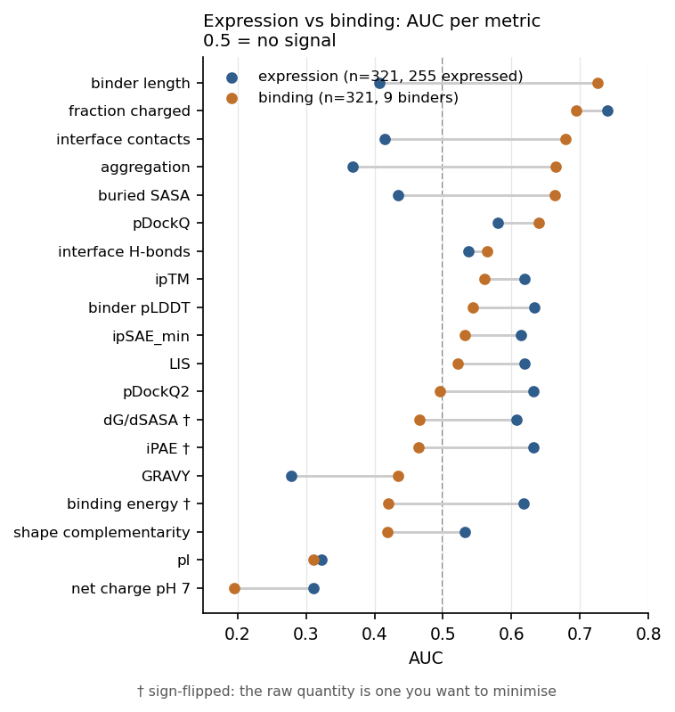
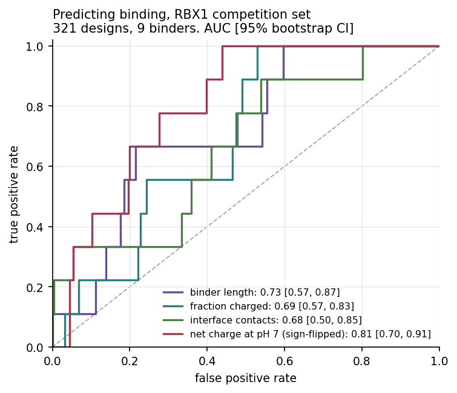
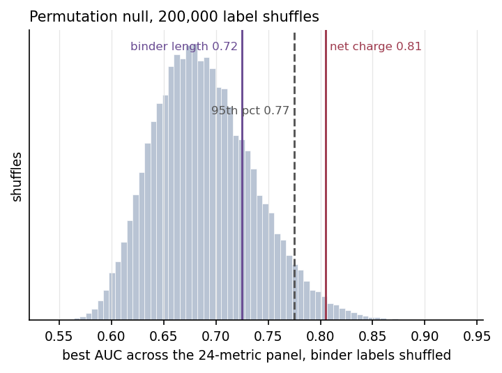

Of the 24 metrics I computed over the 321 measured designs from the GEM/Adaptyv RBX1 competition, the ones that predict whether a design *expresses* are mostly not the ones that predict whether it *binds*, and several of them predict the two in opposite directions.



The metrics are plotted in their raw direction, so distance from the dashed line at 0.5 is what's important and anything to the left of it is predicting in reverse. (The figure shows 19 of the 24; the near-duplicate aggregations are in the tables below.) There are four standout results here:

- **The two charge metrics are the only ones near the top for both.** `seq_fraction_charged` is the best expression predictor at 0.740 and is third for binding at 0.695; net charge at pH 7 is the strongest binding signal and third strongest for expression. Everything else that is good at one is mediocre or reversed at the other.
- **Binder length, interface contacts, buried SASA and aggregation all sit below 0.5 for expression and above it for binding.** These four point one way for binding and the other for expression. 
- **The strongest single binding signal is net charge at pH 7**, which lands at 0.195, or 0.81 when read in the negative direction. A plain sequence property with no structural information in it beats every interface metric here, and every `iface_*` metric except `iface_pdockq` falls within 0.07 of chance, with `iface_iptm` the furthest out at 0.561 and `iface_pdockq2` the closest in at 0.495. Given the disagreement between `iface_pdockq` and `iface_pdockq2` we shouldn't read much into that exception.
- **The interface metrics mainly seem to predict expression, not binding.** The expression side has 255 positives and enough statistical power to determine significance, and there eleven of the 24 metrics clear a permutation-corrected bar, `ipTM`, `LIS`, `pDockQ2` and `iPAE` among them. The same metrics are indistinguishable from noise on binding. These metrics clearly predict expression, but we can't be sure that they predict binding using this data.

With 9 binders out of 321 this is enough to pick out one signal and not enough to judge the rest, so there isn't the statistical power here to say with much confidence what does and doesn't correlate with binding. The rest of this post is how I got there: a pipeline for generating binders, and then a look at how the competition's binders would have scored against the usual selection metrics.

## Why RBX1 is hard

RBX1 is a part of the Cullin-RING E3 ligase complex that tags other unwanted or damaged proteins for destruction and recycling. It does this through a process called ubiquitination, attaching a molecule called ubiquitin to mark proteins for degradation. It plays an important role in cell proliferation and thus cancer, as well as some other diseases, so makes a good target for drugging.

It is difficult to design binders for, though, for a few reasons.

It has a large intrinsically disordered region on the N-terminal. This protein forms part of a larger complex, and without the other subunits pinning it down this region can adopt many conformations. In fact it can still take on different conformations when part of the whole complex, which allows the complex the requisite flexibility to attach ubiquitin to many different proteins. The uncertainty in this region swamps the uncertainty on the rest of the sequence, so metrics like whole complex pTM or pLDDT, or any other metric which doesn't restrict itself to contact residues and which is computed across the whole complex, get tanked by the disordered region even though the uncertainty there might not affect where we would want to bind anyway.

On the other end of the protein it has three zinc ions which get held in a cross-brace sort of position and which AI models usually struggle to place correctly. Without placing these correctly the RING domain won't fold right.

And finally it lacks useful evolutionary relatives or analogues, so MSA based approaches have little to go on.

The scale of the problem shows in the fold-prediction baselines. According to a [blog post by the winners of the competition](https://research.mandrake.bio/p/we-dont-even-design-binders), Mandrake bio, ESMFold reaches pLDDT 0.40 on this target, Protenix ab initio 0.60, Boltz-2 0.63. All of these are uninformative or marginal. In adaptyv's competition, of the 321 designs that were actually measured, only 9 bound to the target and 255 expressed.

Mandrake's ORBIT pipeline took an approach that:

- Used known structure information: They fed Protenix the NMR structure with the ions explicitly placed and the pLDDT rose significantly (predictably). There's no reason not to use this information since the goal here isn't to fold the protein, it's to predict binders.
- Constrained the search space. Standard differentiable hallucination runs trajectories from a uniform prior and thus spends a lot of time trying to find the right neighbourhood rather than doing the interesting refinement. Instead they run DH for a while, inverse fold with SolubleMPNN to get a general structure and then use this as a prior to begin optimisation from.
- They treat each differentiable optimisation run as a trajectory, which allows for thinking about early stopping using a classifier or recognising that the argmax projection could degrade during this process so they can instead harvest the best sequence along the trajectory.
- Use an attractive field in coordinate space that pulls the binder towards high-value target residues. Would be interesting to compare against the distogram based methods which bias which residues form contacts but not how the binder gets drawn to them.
- By applying a regularisation layer to the PSSM the optimiser gets pushed towards not just what the structural model thinks is high probability, but also towards other desirable properties (hydrophobicity, net charge).

This last point is the most interesting to me, we can look at which properties are most important from this competition. Doing this is fraught with all kinds of problems however:

1. The designs come pre-filtered, only the designs which passed selection make it into the datasets, so any analysis you do automatically loses power
2. The selection can change between competitions, for instance in the Nipah competition they selected 600 designs based on Boltz-2 ipSAE, 400 selected by a panel of experts, and 200 chosen by community vote.
3. Before even making it to the selection stage, designs are prefiltered by the contestants using various filters, [some may even experimentally test their designs before submission](https://x.com/sokrypton/status/1998208058632351861).
4. The selection metrics are biased towards certain structural motifs, α-helical proteins for instance, which further biases any analysis.

Adaptyv has run several of these competitions: A two stage competition aiming to find binders for EGFR, one aiming for binders of the Nipah virus, and the aforementioned RBX1 competition.

In the first adaptyv competition on EGFR iPAE, ipTM and ESM-2 pseudo-likelihood were used as selection mechanisms. Also additional binders were selected to increase diversity in the final released dataset, so the above concerns are well known. One of the results that stood out to me in [their write up](https://www.biorxiv.org/content/10.1101/2025.04.17.648362v2.full.pdf) was that lumping all designs together meant that metrics that might only show significance on say, peptides, would be marked down as insignificant. In fact the winning design was completely overlooked by the above metrics. In the Nipah competition ipSAE was chosen, but it had issues in that scores would vary slightly due to random seed and this variability was not uniform across designs, which may have advantaged designs which gave more stable scores. All of this is to say that determining *in-silico* whether a design will bind is quite challenging. In a [2025 paper](https://www.biorxiv.org/content/10.1101/2025.08.14.670059v2) Overath et al. propose the following selection criteria:

"Based on our analysis, we recommend the following actionable filtering strategies. The first involves setting one of the following thresholds for filtering designs: AF3 ipSAE_min > 0.61; AF3 ipSAE_min x interface_∆G/∆SASA < -1.5; or AF3 LIS x input_interface_shape_complementary > 0.42. The second strategy entails pre-filtering designs using input_interface_shape_complementary > 0.62 and RMSD_binder < 3.73, followed by selecting the top K designs based on AF3 ipSAE_min"

I thought it would be worthwhile to build a binder generation pipeline informed somewhat by Mandrake's pipeline and then see how the 9 binders from the competition would have fared against the aforementioned metrics and selection criteria. In line with Mandrake's proposal we will use protenix in place of AF3 to calculate metrics.

### My pipeline

I used Claude Code for most of the plumbing here and specified the binding site myself. The pipeline ended up looking like:

```
target structure + hotspot residues
        |  RFdiffusion            (generate backbone shapes)
        v
   backbone PDBs (no meaningful sequence)
        |  SolubleMPNN            (sequence for each backbone)
        v
   candidate sequences
        |  ESM-2                  (rank by "naturalness")
        v
   shortlist
        |  Protenix / Boltz-2     (fold binder + target together)
        v
   predicted complexes + PAE, ipTM, pLDDT
        |  ipSAE, pDockQ, ...     (interface scoring from those outputs)
        v
   feature table
```

First we can do a few sanity checks of this pipeline: when we generate binders do they make sense, do we actually make contact with the binding site etc.

### Do we make contact?
The first question is: when we use RFDiffusion to design binders against our fold from protenix, do we actually make contact with the binding sites we specify (A74/F81/Y106, chosen somewhat arbitrarily although I excluded the disordered region)? The answer seems to be yes for at least one of the sites and "somewhat" if we want to contact all three sites. We don't necessarily need a binder to contact all 3 hotspots so contacting just one is a good sign that we are on target.


| run | n backbones | contact >=1 hotspot | contact all 3 hotspots |
|---|---|---|---|
| smoke test | 20 | 20 (100%) | 5 (25%) |
| scale-up | 200 | 196 (98%) | 61 (30.5%) |


### Are the sequences self consistent?
RFDiffusion gives us a structure which hopefully gets nice and close to our stated binding spots, which we can then reverse-fold into a sequence using SolubleMPNN. The natural question is then: If we do this and then refold the sequences do we get back to something that looked like the original sequence we proposed, or does SolubleMPNN just hallucinate something that doesn't give us the sequence we want? Unfortunately since we don't get the original sequences from the 322 released contest entries we can't check this for them, but we can test the generated backbones from the last step.

| | value |
|---|---|
| backbones | 200 |
| sequences (8 MPNN samples/backbone) | 1600 |
| median self-consistency RMSD (best seq/backbone) | 0.64 A |
| mean self-consistency RMSD (all 1600) | 4.32 A |
| backbones with >=1 sub-2A design | 183 / 200 (91.5%) |

Looks pretty good, SolubleMPNN clearly does a good job at this.

## Evaluating the published dataset
In the next couple of sections we will take a look at what metrics predict expression and binding in the set of proposed binders released after the competition. 

Throughout, AUCs are reported in each metric's raw direction, except the error and energy metrics marked *(sign-flipped)*, where the raw quantity is one you want to minimise. Average precision is raw throughout, which matters for the metrics that predict in reverse. An AUC below 0.5 doesn't mean the metric is useless, it means it predicts in reverse: subtract it from 1 to get its strength in the other direction. So what matters is distance from 0.5, not just the size of the number.

### Expression (n=321, 255 expressed)
Before a design can bind to the target it must express, meaning they must be able to be produced in the assay Adaptyv used. (322 designs were released but one, `ivory-dove-granite`, carries no experimental record of any kind, so every number here is over the 321 that were actually measured.)

| metric | AUC |
|---|---|
| `seq_fraction_charged` | **0.740** |
| `binder_mean_plddt` | 0.633 |
| `iface_pdockq2` | 0.632 |
| `iface_ipae` *(sign-flipped)* | 0.631 |
| `iface_lis` | 0.620 |
| `iface_iptm` | 0.619 |
| `struct_binding_energy` *(sign-flipped)* | 0.618 |
| `iface_ipsae_min` | 0.614 |
| `struct_dg_dsasa_ratio` *(sign-flipped)* | 0.608 |
| `iface_i_pdae` (symmetrised) | 0.607 |
| `iface_ipsae` | 0.605 |
| `iface_i_pdae_asymmetric` | 0.603 |
| `iface_pdockq` | 0.580 |
| `struct_interface_hbonds` | 0.537 |
| `struct_shape_complementarity` | 0.532 |
| `struct_interface_hydrophobicity` | 0.509 |
| `struct_interface_hydrophobic_fraction` | 0.494 |
| `struct_buried_sasa` | 0.435 |
| `struct_contacts` | 0.415 |
| `binder_length` | 0.406 |
| `seq_aggregation` | 0.368 |
| `seq_pi` | 0.323 |
| `seq_net_charge_ph7` | 0.311 |
| `seq_gravy` | 0.278 |

This makes sense, the SolubleMPNN weights were shown to be very important to get binders which expressed (93% to 0% difference!) and it tends to raise the surface charge of the proteins it predicts.

pLDDT and iPAE, the folding model's confidence in its own predictions on a per residue level and predicted aligned error respectively, are inherited by or correlated with a lot of the interface metrics. It makes sense for these to be positively correlated with expression: if the model is more confident that it has predicted the structure right, or if it predicts a lower average error when aligning on all the residues, the design is probably more plausible as a real structure. Maybe. And as we will see, expression doesn't guarantee binding.

The expression side is also the half of this dataset with enough positives to speak confidently on. Running a 24-metric permutation test here, where 255 positives put the best-of-panel null at 0.58 rather than 0.69, eleven of the 24 clear the bar: the four charge and hydropathy metrics (`seq_fraction_charged`, `seq_pi`, `seq_net_charge_ph7`, `seq_gravy`) overwhelmingly, at p < 0.0001, then `binder_mean_plddt`, `seq_aggregation`, `iface_pdockq2`, `iface_ipae`, `iface_lis`, `iface_iptm` and `struct_binding_energy` between 0.011 and 0.042. So the interface-confidence metrics predict expression well here.

It's worth noting that what really constrains our confidence here isn't the 255 expressors, it's the 66 failures: the minority class determines the standard error. With 66 of them the bar a metric needs to pass sits at about 0.61 and the smallest effect I could reliably catch is around AUC 0.64, which is why eleven metrics clear it here and, as we'll see, we struggle to make reliable inferences with only 9 recorded binders.

Another problem with these metrics is that they are, of course, biased towards proteins which already exist and which were in the training set of whichever folding model you use, and we are interested in generating and selecting novel proteins.


### Binding (n=321, 9 binders)

There are far fewer binders than expressors, so these results need to be taken with a proportionally larger pinch of salt.

| metric | AUC | average precision |
|---|---|---|
| `binder_length` | 0.725 | 0.164 |
| `seq_fraction_charged` | 0.695 | 0.058 |
| `struct_contacts` | 0.678 | **0.230** |
| `seq_aggregation` | 0.664 | 0.049 |
| `struct_buried_sasa` | 0.663 | 0.208 |
| `iface_pdockq` | 0.640 | 0.058 |
| `struct_interface_hbonds` | 0.564 | 0.088 |
| `iface_iptm` | 0.561 | 0.100 |
| `binder_mean_plddt` | 0.543 | 0.034 |
| `iface_i_pdae` (BindCraft2, symmetrised) | 0.539 | 0.091 |
| `iface_ipsae_min` (Overath et al.'s preferred aggregation) | 0.532 | 0.090 |
| `iface_ipsae` (tool's default "max" aggregation) | 0.531 | 0.047 |
| `iface_i_pdae_asymmetric` | 0.523 | 0.053 |
| `iface_lis` | 0.522 | 0.042 |
| `struct_interface_hydrophobic_fraction` (BindCraft's definition) | 0.516 | 0.032 |
| `struct_interface_hydrophobicity` (area-weighted) | 0.506 | 0.033 |
| `iface_pdockq2` | 0.495 | 0.042 |
| `struct_dg_dsasa_ratio` *(sign-flipped)* | 0.466 | 0.029 |
| `iface_ipae` *(sign-flipped)* | 0.464 | 0.035 |
| `seq_gravy` | 0.434 | 0.027 |
| `struct_binding_energy` *(sign-flipped)* | 0.420 | 0.027 |
| `struct_shape_complementarity` | 0.418 | 0.026 |
| `seq_pi` | 0.310 | 0.021 |
| `seq_net_charge_ph7` | **0.195** | 0.018 |

Read by distance from 0.5, the top of this table is `seq_net_charge_ph7` at 0.195, which is 0.81 in the negative direction. More negatively charged designs bind more often, and `seq_pi` at 0.310 says the same thing from a different viewpoint. It's interesting to note that a sequence-level property with no structural information in it is the strongest signal here, while `ipSAE_min`, `LIS`, `pDockQ2` and the rest of the `iface_*` panel, that selection pipelines are usually built around, and which are computed by looking at structure, all fall within 0.07 of chance, apart from `iface_pdockq` (although we probably shouldn't read much into this given `pdockq2` falls within chance): `iface_iptm` is the furthest out at 0.561 and `iface_pdockq2` the closest in at 0.495.

### Is any of this real?

The ROC curves for four of the strongest signals, dropping `seq_pi` as a near-duplicate of net charge, make the sample size obvious: with 9 positives every step is one design, and a single relabelled design moves the curve visibly.



(An ROC curve has to be oriented one way, so `seq_net_charge_ph7` is drawn sign-flipped here and reads 0.81 rather than the 0.195 in the table above. Same ordering but just pointed the other way.)

The bracketed numbers in the legend are 95% percentile bootstrap intervals over 10,000 resamples of the 321 designs, and they are very wide, which is a big reason not to over-read any of this. Interface contacts at 0.68 [0.50, 0.85] has an interval that reaches chance, so with nine positives this can't be particularly conclusive.

Those intervals are also conditional on having already chosen the metric. The null standard deviation of a single AUC at this sample size is 0.098, so the right question is not whether a metric beats 0.5, it's whether it beats what the best of 24 would reach anyway. Shuffling the binder labels 200,000 times and taking the best metric in the panel each time gives the answer directly.



The bar is around 0.69, not 0.5, and one shuffle in twenty puts the best metric above 0.77 with no signal in the data at all. Only net charge clears it, at 0.81 with a family-wise p of 0.015. Binder length (0.725) and fraction charged (0.695) sit inside the null, which means I can't separate them from noise here.

What's becoming clear as I do this is that nine binders out of 321 is enough to pick out one signal and not enough to judge the rest, which argues for looking beyond a single target or generating more binders for RBX1.

Putting a number on it: with nine positives the corrected bar is 0.77, and the smallest true effect I could catch 80% of the time is an AUC of **0.83**. Anything weaker than that won't show up here.

| true AUC | chance of clearing the bar at 9 binders |
|---|---|
| 0.60 | 3% |
| 0.65 | 9% |
| 0.70 | 21% |
| 0.75 | 40% |
| 0.80 | 64% |
| 0.85 | 88% |

Note the 0.80 row. A metric exactly as good as net charge appears to be would clear this bar only about two times in three. (Each row is 2,000 simulated metrics. I generated the metric two ways, from a normal model and by resampling the real net charge values and relabelling them to hit the target AUC, since the real metrics are skewed and have a lot of ties. The two agree to within a couple of points, so it doesn't seem to matter which.)

I did wonder whether I could lower the bar by testing fewer things, since a lot of the panel is near-duplicated: `ipSAE` and `ipSAE_min`, `i_pdae` and its asymmetric version, the three hydrophobicity variants. But it doesn't really change things. A panel of 24 uncorrelated metrics gives a bar of 0.79 and the real one gives 0.775. Matching that against simulated independent panels puts this one at about 13 effective metrics rather than 24.

Having said this, lets still take a look at what charge might tell us about the binders and the target.

### So if the binders are negatively charged...

It makes sense at this point to ask the obvious question: Is there some physical reason why the binders have lower net charge than the non-binders? For instance are the binding sites of RBX1 strongly positively charged, rewarding more negatively charged binders? 

| | binder median | non-binder median | AUC | p-value |
|---|---|---|---|---|
| actual_site_net_charge (all real contacts) | -0.781 | -0.782 | 0.597 | 0.3211 |
| actual_site_net_charge (ordered contacts only, excl. 1-39) | -1.052 | -0.783 | 0.473 | 0.7765 |

There isn't really any signal here so it isn't clear why lower charge binders seem to do better.

### Which binders would survive Overath et al.'s filter

- *Threshold strategy* (`ipSAE_min > 0.61` OR `ipSAE_min x interface_dG/dSASA < -1.5` OR
  `LIS x shape_complementarity > 0.42`): 63/321 designs pass; of those, 3/9 are real binders
  (precision 4.8% vs a 2.8% base rate). With `ipSAE_min > 0.61` alone: 61/321 pass, 3/9 binders caught.
- *Ranking strategy* (prefilter on shape complementarity + RMSD_binder, then rank survivors by
  ipSAE_min): the RMSD_binder prefilter needs a reference/design structure that these archived
  competition designs don't give us, so only the shape-complementarity prefilter is applied here.

  Then if we have k testing budget we can ask "of the available designs in the top-k, how many are binders?"

  | k | designs available | binders caught | precision |
  |---|---|---|---|
  | 10 | 10 | 1 | 10.0% |
  | 20 | 20 | 1 | 5.0% |
  | 50 | 50 | 2 | 4.0% |
  | 100 | 72 | 2 | 2.8% |

So we don't really do all that well if this is all we rely on.

### How do my own designs stand up

Because I am able to provide my own structures on the 10 designs I produced we can run the full prefilter. In this case only **1 of 10** of my designs passes both `struct_shape_complementarity > 0.62` and `struct_binder_rmsd < 3.73 A` at once (`bb_4_sample3`, Sc=0.622, RMSD_binder=3.28 A). Here it is in its predicted binding spot:

<div id="viewer-bb4sample3" style="width: 100%; height: 420px; position: relative;"></div>
<script>
(function () {
  var viewer = $3Dmol.createViewer("viewer-bb4sample3", {backgroundColor: "white"});
  $3Dmol.download("url:/structures/own_overath_survivor_bb_4_sample3.cif", viewer, {format: "cif"}, function () {
    viewer.setStyle({chain: "A"}, {cartoon: {color: "lightgrey"}});
    viewer.setStyle({chain: "B"}, {cartoon: {color: "orange"}});
    viewer.setStyle({resn: "ZN"}, {sphere: {color: "purple", radius: 0.6}});
    viewer.zoomTo();
    viewer.render();
  });
})();
</script>

Its predicted `ipSAE_min` is only 0.404 so wouldn't pass the 0.61 single metric threshold.

If we just look at `ipSAE_min` our best binder is as follows, even though this fails the shape complementarity test (0.523, short of 0.62):

<div id="viewer-bb16sample1" style="width: 100%; height: 420px; position: relative;"></div>
<script>
(function () {
  var viewer = $3Dmol.createViewer("viewer-bb16sample1", {backgroundColor: "white"});
  $3Dmol.download("url:/structures/own_best_bb_16_sample1.cif", viewer, {format: "cif"}, function () {
    viewer.setStyle({chain: "A"}, {cartoon: {color: "lightgrey"}});
    viewer.setStyle({chain: "B"}, {cartoon: {color: "orange"}});
    viewer.setStyle({resn: "ZN"}, {sphere: {color: "purple", radius: 0.6}});
    viewer.zoomTo();
    viewer.render();
  });
})();
</script>

Without experimental confirmation we can't say definitively which is better.

For completeness here is the winner of the binding competition in the position that my pipeline predicts for it:

<div id="viewer-small-vole-maple" style="width: 100%; height: 420px; position: relative;"></div>
<script>
(function () {
  var viewer = $3Dmol.createViewer("viewer-small-vole-maple", {backgroundColor: "white"});
  $3Dmol.download("url:/structures/competition_winner_small-vole-maple.cif", viewer, {format: "cif"}, function () {
    viewer.setStyle({chain: "A"}, {cartoon: {color: "lightgrey"}});
    viewer.setStyle({chain: "B"}, {cartoon: {color: "teal"}});
    viewer.setStyle({resn: "ZN"}, {sphere: {color: "purple", radius: 0.6}});
    viewer.zoomTo();
    viewer.render();
  });
})();
</script>


The winning binder definitely looks more complicated than both of the ones I generated.


### Some final thoughts

It would be cool if in future competitions the design structures and predicted co-folds could be included, perhaps along with predicted epitope. I don't think it would be that much to ask competitors to include this and would be a useful tool for analysis. For instance, I'm interested to know where binders were predicted to land on RBX1 by the competitors' pipelines and how this prediction would differ using my own pipeline.

The other thing these numbers argue for is more positives. At the competition's 2.8% hit rate, 80% power against a moderately useful metric needs this many designs through the assay:

| true AUC you want to detect | binders needed | designs to assay |
|---|---|---|
| 0.60 | 122 | ~4,400 |
| 0.65 | 53 | ~1,900 |
| 0.70 | 29 | ~1,000 |
| 0.75 | 18 | ~640 |

That's three to six times the size of this round to resolve anything in the 0.65 to 0.70 range, which is probably not going to happen. This assumes that in any set of designs around 2.8% are binders, but that's only in this set proposed designs. So in reality we would probably need to assay many more designs to hit these numbers.

The expression side has the same problem at the other end. It looks well powered, but that comes from the 66 failures rather than the 255 successes. This would be an easier fix, just assay more designs that don't pass the filters. That would probably raise the failure rate a bit.

Remaining questions:

1. How do you select binding sites, can this be done after folding by calculating things about the protein?
2. How can I generate more diverse binders?
3. Can I replicate Mandrake's unpublished pipeline based on their blog post?
4. Given a set of binders and some metrics how do I best select and rank them?
5. How do I iterate on a pipeline like this to generate better binders?